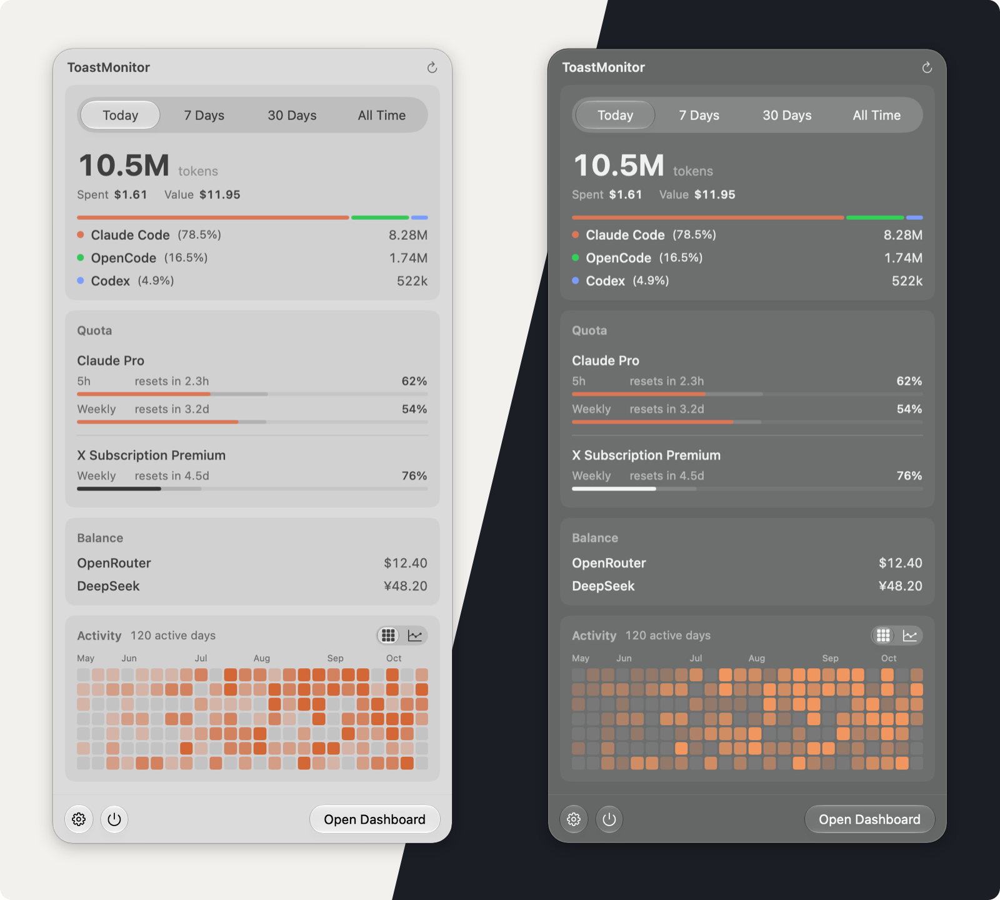
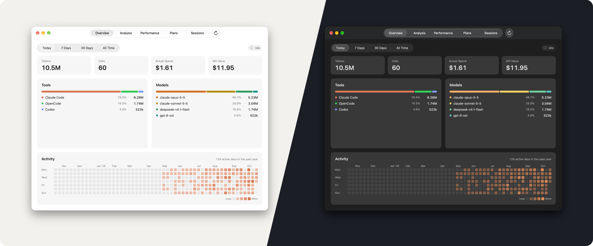
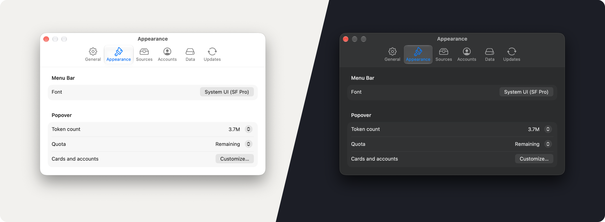

# ToastMonitor

[](https://github.com/Toast1zz/ToastMonitor)
[](Package.swift)
[](LICENSE)

A native macOS menu-bar monitor for AI coding usage. It reads the local logs of **Claude Code, Codex, OpenCode, Hermes, Oh My Pi and DeepSeek Harness**, checks your subscription quotas and prepaid balances, and keeps today's token total in the menu bar. SwiftUI and the system SQLite, no third-party dependencies.

<p align="center">
  
</p>

<sub>Screenshots use made-up demo data.</sub>

## What you get

**The menu bar** shows today's tokens. Click it for the panel.

**The panel** separates what you used from what you have left:

- **Usage** — pick Today, 7 Days, 30 Days or All Time. You get the token total, what you actually spent, what the same calls would cost at API list prices, and the share of each tool. The period switch sits inside this card because it changes only these numbers.
- **Quota** — one bar per subscription window (Claude 5h and weekly, OpenCode Go, Codex, Command Code, Grok) with its reset countdown. The darker part of each track shows how much of the window's time has passed, so a bar that runs past it means you are using the quota faster than time.
- **Balance** — OpenRouter and DeepSeek prepaid credit, one short line each. An account gets its own highlighted line only when it will run out within about a week at your recent pace, is empty, or cannot be read.
- **Activity** — the last 24 weeks as a heatmap, or the last 60 days as a trend line.

When an account cannot refresh, a small question mark appears next to it; click it for what went wrong and how to fix it. `Settings → Appearance → Customize…` chooses which cards and accounts appear.

**The dashboard** has five pages that each fit the window without scrolling:

- **Overview** — period figures, tool and model breakdowns, a year of activity
- **Analysis** — tokens or estimated cost per day by tool or model over 7, 30 or 90 days, with CSV export
- **Performance** — output speed and time to first token per model, by day
- **Plans** — one card per connected account with its quota windows, balance and history
- **Sessions** — every session, newest first, grouped by day

<p align="center">
  
</p>

**Settings** (⌘, or the panel's gear) is a standard macOS settings window: General, Appearance, Sources, Accounts, Data and Updates. Updates are signed and installed in place after you confirm.

<p align="center">
  
</p>

## Data sources

| Tool | Read from this Mac | Remote |
|---|---|---|
| Claude Code | `~/.claude/projects/*/*.jsonl`, plus Claude Desktop Cowork sessions run in local agent mode | VPS feed |
| Codex | `~/.codex/sessions/.../rollout-*.jsonl` + `state_5.sqlite` | VPS feed |
| OpenCode | `~/.local/share/opencode/opencode.db` | VPS feed |
| Hermes | `~/.hermes/state.db` | VPS feed |
| Oh My Pi | `~/.omp/agent/sessions/**/*.jsonl` | — |
| DeepSeek Harness | `$DSH_HOME` (default `~/.dsh`) session logs and projection cache | — |
| OpenRouter | Cloud API (key and credit snapshots) | — |
| DeepSeek account | Platform balance and account-wide billing, or balance only with an API key | — |

Remote feeds are contacted only at addresses you add yourself in `Settings → Sources`; nothing is preconfigured. Local and remote sources can be turned off independently.

**Claude usage outside this Mac.** Cowork, claude.ai chat and Claude Code on other machines leave no local transcript. ToastMonitor estimates their tokens from how the shared Claude quota moves while this Mac is idle, and shows the result as the "Cowork & web" row. It is an estimate and likely a lower bound: the quota is only sampled while the panel or dashboard is open.

## Accounts and quotas

All quotas are built in; no opencode-quota install is needed.

- **Claude** (opt-in, off by default) — 5h, weekly and weekly-Opus windows from `api.anthropic.com/api/oauth/usage`, using the login Claude Code already saved on this Mac. Nothing to paste. The login is read from `~/.claude/.credentials.json` and the `Claude Code-credentials` Keychain item without ever prompting, and ToastMonitor never changes that item. When the login has expired, ToastMonitor starts `claude` once in the background to refresh it, unless macOS has quarantined that `claude` binary (for example right after a Homebrew update); then it asks you to run `claude` in Terminal instead of triggering a Gatekeeper dialog.
- **Grok** (experimental) — the weekly pool your Grok plan shares across Grok Chat, Imagine, Build / CLI and Grok Bot, read with the token `grok login` stores in `~/.grok/auth.json` (never copied). The API still reports some X Subscription plans as "SuperGrok"; add the plan in `Settings → Sources → Subscriptions` to show its real name.
- **OpenCode Go** — rolling, weekly and monthly usage from your OpenCode workspace. Paste the workspace and cookie in `Settings → Accounts`, or use `--provision-go`.
- **Codex** — the ChatGPT plan's usage, read with the login Codex keeps in `~/.codex/auth.json` (never copied).
- **Command Code** (experimental) — paste your Studio session cookie in `Settings → Accounts`; it is kept only in the Keychain. The billing endpoint is not a public API and may change.
- **OpenRouter** — key and credit snapshots every 60 seconds while the panel is open, every 5 minutes otherwise. The key lives only in the Keychain.
- **DeepSeek** — balance, plus account-wide spend for Platform logins, including other devices ([connect guide](docs/connect-deepseek.md)).

## Install and build

Download the latest release from [Releases](https://github.com/Toast1zz/ToastMonitor/releases) (arm64 for Apple Silicon, universal for Intel).

macOS blocks the first launch. Try opening the app once, then go to System Settings → Privacy & Security and click Open Anyway.
The app is not notarized. To verify your download, run `shasum -a 256 <downloaded-file>` and compare the result with the checksum on the release page.

Or build it:

```bash
./scripts/build-app.sh        # release build → code sign → install to /Applications
```

- After switching to Apple Development signing for the first time, run `./scripts/authorize-local-keychain.sh` once. It only touches ToastMonitor's own Keychain items.
- Versions come from `vMAJOR.MINOR.PATCH` git tags. Untagged local builds are `1.0`; `TM_VERSION` overrides it for release builds.
- `build-app.sh` refuses ad-hoc signing; pass an identity with `TM_SIGNING_IDENTITY`.

### Releasing

Each release ships an arm64 and a universal zip plus a signed, architecture-aware update manifest (`appcast.json`) that drives `Settings → Updates`. The manifest is Ed25519-signed with a key that never leaves the maintainer's machine (`~/.config/toastmonitor/update-key.pem`, 0600); the app carries the public half.

```bash
git tag vX.Y.Z
./scripts/package-release.sh
gh release create vX.Y.Z dist/release/*.zip --title "ToastMonitor vX.Y.Z" --notes-file docs/release-vX.Y.Z.md
./scripts/sign-update-manifest.sh X.Y.Z \
  dist/release/ToastMonitor-X.Y.Z-arm64.zip \
  dist/release/ToastMonitor-X.Y.Z-universal.zip
cp appcast.json docs/appcast.json
git commit -am "Publish update manifest for vX.Y.Z" && git push
```

- The feed is served from GitHub Pages (`https://toast1zz.github.io/ToastMonitor/appcast.json`, deployed from `docs/`); check it with `curl -s` after publishing.
- Download URLs are tag-pinned (`/releases/download/vX.Y.Z/…`), never `/releases/latest/`.
- The updater verifies the download before installing, keeps the old app as `ToastMonitor.app.tm-backup` until the new one starts, and reports a failed install in `Settings → Updates`.

## Command line

```bash
# Credentials always come from stdin, never argv
printf '%s\n' 'sk-or-...' | ToastMonitor.app/Contents/MacOS/ToastMonitor --provision-or-key
printf '%s\n' 'auth_cookie' | ToastMonitor.app/Contents/MacOS/ToastMonitor --provision-go <workspaceId>
ToastMonitor.app/Contents/MacOS/ToastMonitor --provision-hermes <feedURL>
ToastMonitor.app/Contents/MacOS/ToastMonitor --clear-or-key
```

Development and screenshots:

- `TM_DEBUG=1` logs each file-scan decision.
- `--show-panel`, `--show-dashboard` and `--show-settings [pane]` open the real windows without starting collectors or reading the Keychain; `--appearance light|dark` picks the look.
- `--demo` fills them with made-up usage, quotas and balances. It requires `TM_DATABASE_PATH` pointing at a throwaway database, so it can never touch your real data. The README screenshots are made this way.
- `--render-popover`, `--render-dashboard` and `--render-settings` write offscreen PNGs; native controls are not drawn there.
- `--verify-status-toggle` and `--verify-quota-badge` are CI self-checks.

## How it works

- **One collection loop** — scans every second while the panel is open and every 5 seconds otherwise. Files are read incrementally, keyed on size, nanosecond mtime and inode, so an idle scan is only `stat` calls. Large JSONL and DeepSeek Harness logs are streamed in bounded chunks rather than loaded whole.
- **One SQLite store** — `~/Library/Application Support/ToastMonitor/toastmonitor.db` (WAL).
- **Cost estimates** — a built-in price table for common models; unknown models count tokens without a price, and OpenCode's own cost is used when present.
- **DeepSeek Harness** — parses the zstd-compressed session logs when the `zstd` CLI is installed, otherwise falls back to the projection cache (no model or per-call timing). The mode never switches once chosen, so the two can't double-count.

## Privacy and security

- Logs, usage, project paths and session metadata stay in the local database. Requests go only to quota services and remote feeds you enabled.
- Credentials live in the macOS Keychain, never in URLs, plists or logs. No analytics or ad SDKs.
- Updates are downloaded only after you confirm, and the signature, version and SHA-256 are checked before anything is installed.
- `Settings → Data` exports, backs up, restores and clears the database; clearing makes a protected backup first.

## Known limitations

- The menu bar shows today's tokens only; cost and subscriptions live in the panel.
- Claude usage outside this Mac is estimated from the shared quota, never counted in tokens.
- Prices are approximate official list prices.
- Without the `zstd` CLI, DeepSeek Harness usage has no model, so its cost is 0.

## Contributing

See [CONTRIBUTING.md](CONTRIBUTING.md) for the build, test and pull-request workflow, and [SECURITY.md](SECURITY.md) for reporting vulnerabilities.

## Acknowledgements

Thanks to [@yeyebbc](https://github.com/yeyebbc) for [#4](https://github.com/Toast1zz/ToastMonitor/pull/4), which releases transient read buffers during collector scans and cut scan peak memory by more than 80% in the bundled benchmark.

The menu bar icon was contributed by [@yeyebbc](https://github.com/yeyebbc) in [#6](https://github.com/Toast1zz/ToastMonitor/pull/6).

## License

MIT — see [LICENSE](LICENSE). Third-party system components remain under their own licenses.
